# SteamU

<p align="center">
  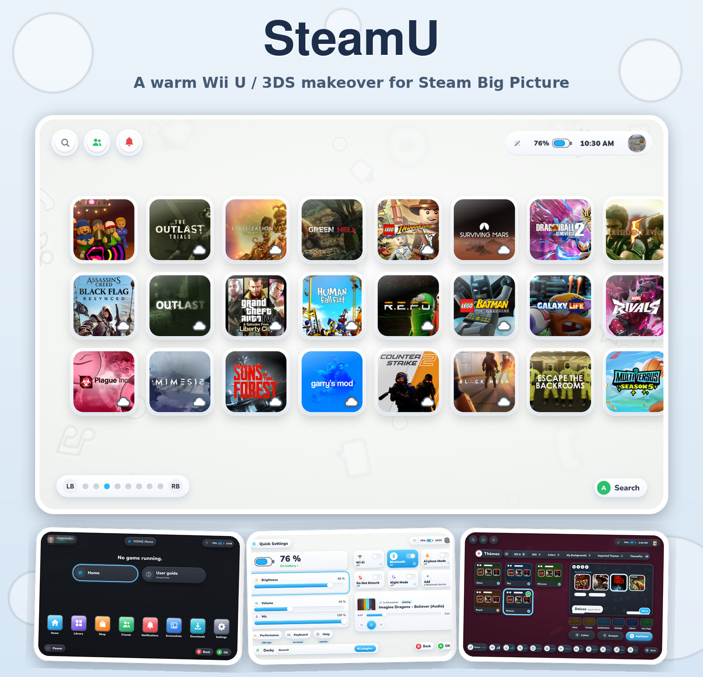
</p>

SteamU is a [Decky Loader](https://decky.xyz) plugin that gives Steam's Big Picture / gamepad UI a warm,
Wii U / 3DS-inspired makeover: a grid home screen, a HOME menu, full-screen quick settings, a set of complete
themes (day and night), a music player, a "plaza" screen, a Mii Maker, a badge-collecting casino mini-game, and
more. It is still labelled `v0.1.5-test`: expect rough edges, and please open an issue if something looks wrong.

See [`ARCHITECTURE.md`](ARCHITECTURE.md) for how the plugin works internally.

## Screenshots

<p align="center">
  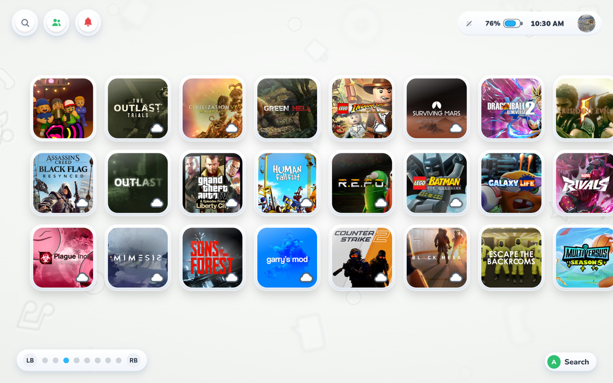
  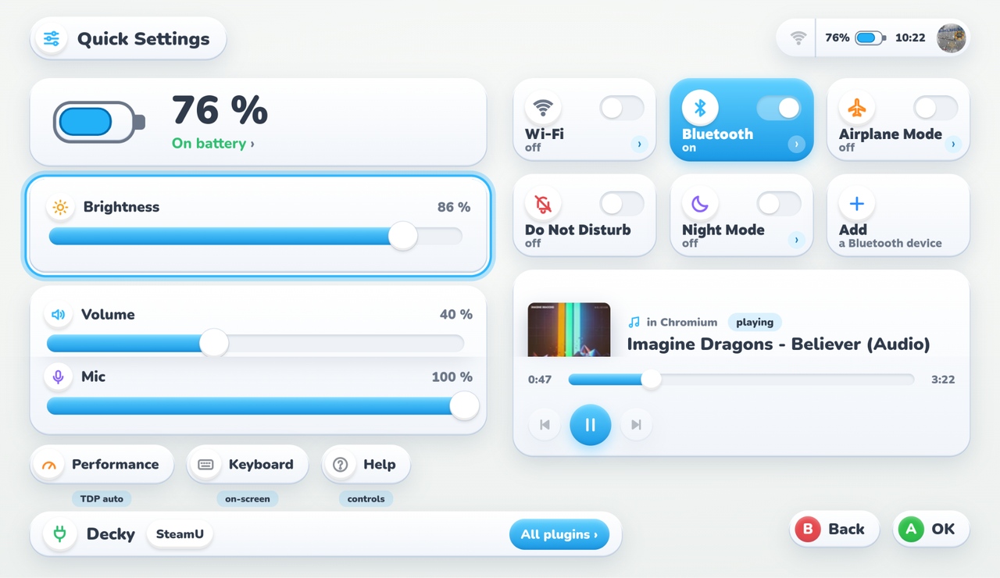
  
</p>

<details>
<summary>Home grid and HOME menu</summary>
<br>

The grid home screen, and the HOME menu reachable from any screen.


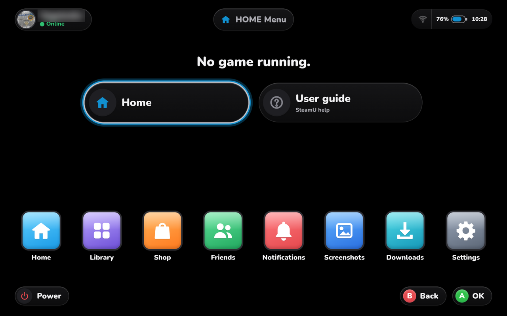
</details>

<details>
<summary>Quick settings</summary>
<br>

Full-screen quick settings: brightness, volume, Wi-Fi, Bluetooth, Do Not Disturb, Night Mode, performance, and
whatever is currently playing.


</details>

<details>
<summary>Music and lyrics</summary>
<br>

A full-screen music player for whatever is playing on the console (any app exposing MPRIS), with an optional,
opt-in lyrics view synced to playback, fetched from LRCLIB.

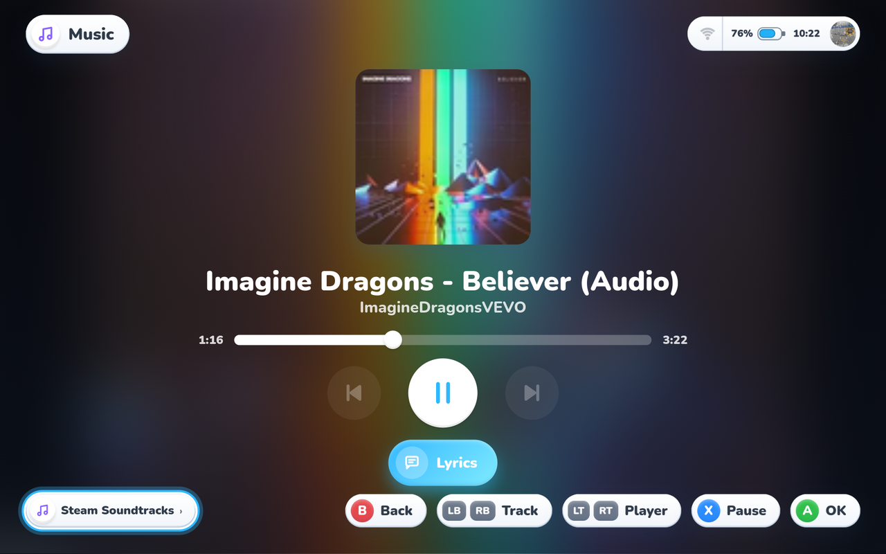
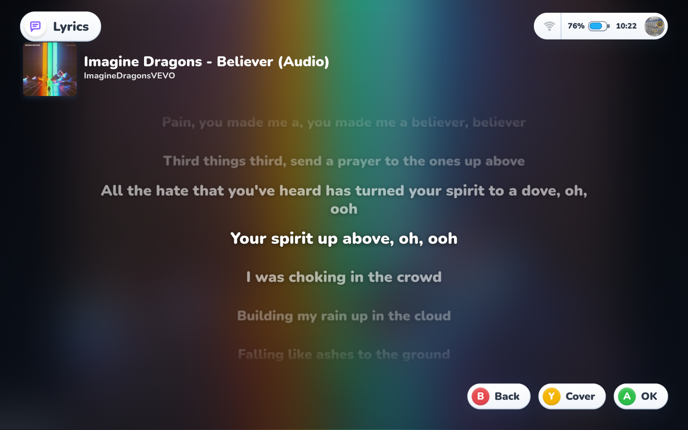
</details>

<details>
<summary>Themes</summary>
<br>

Complete themes, each with its own day and night look: four of the built-in Wii U family themes shown in both
variants ("Glass", the default, looks much the same idea in a cooler white).


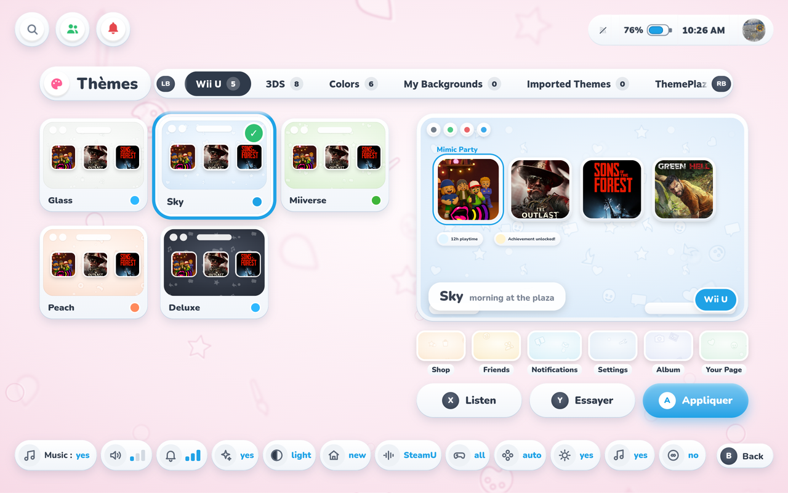
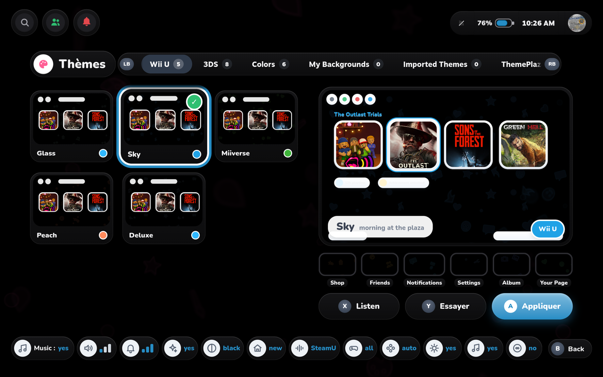
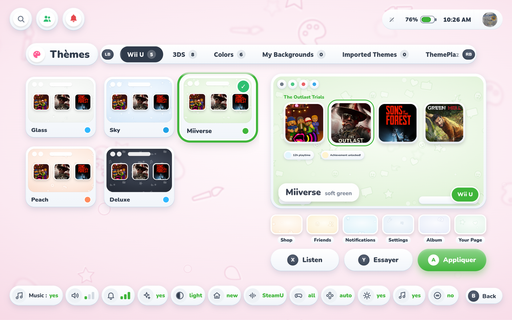
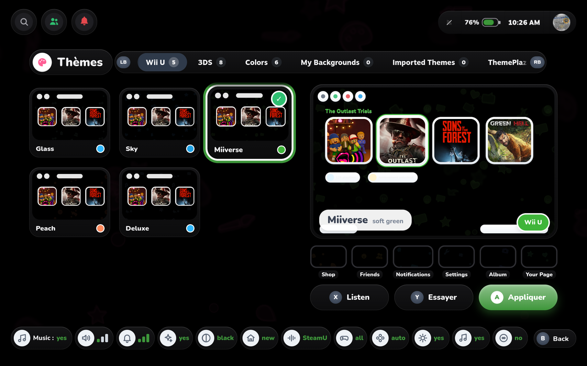
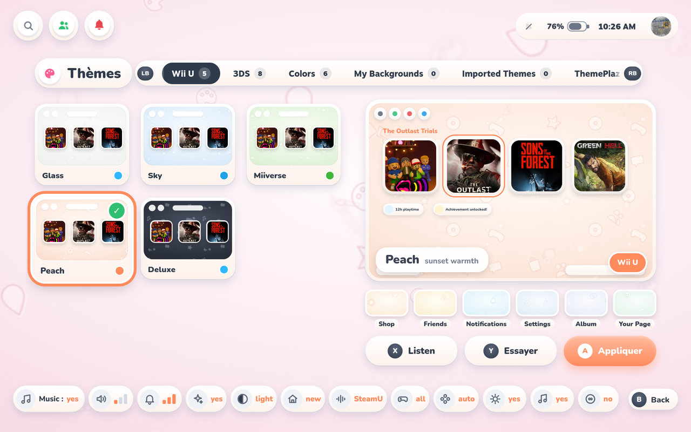
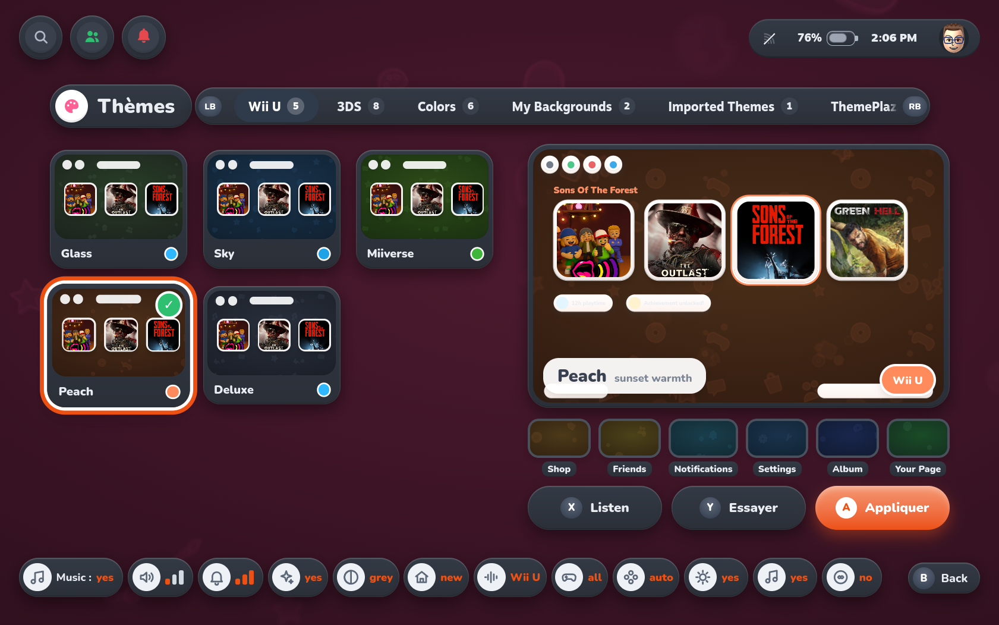
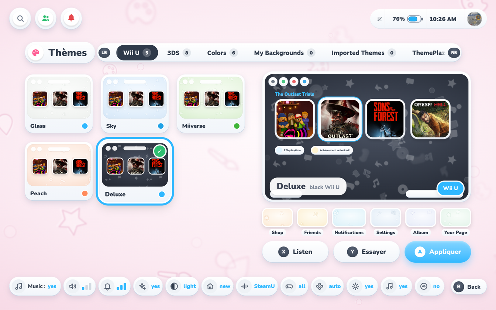
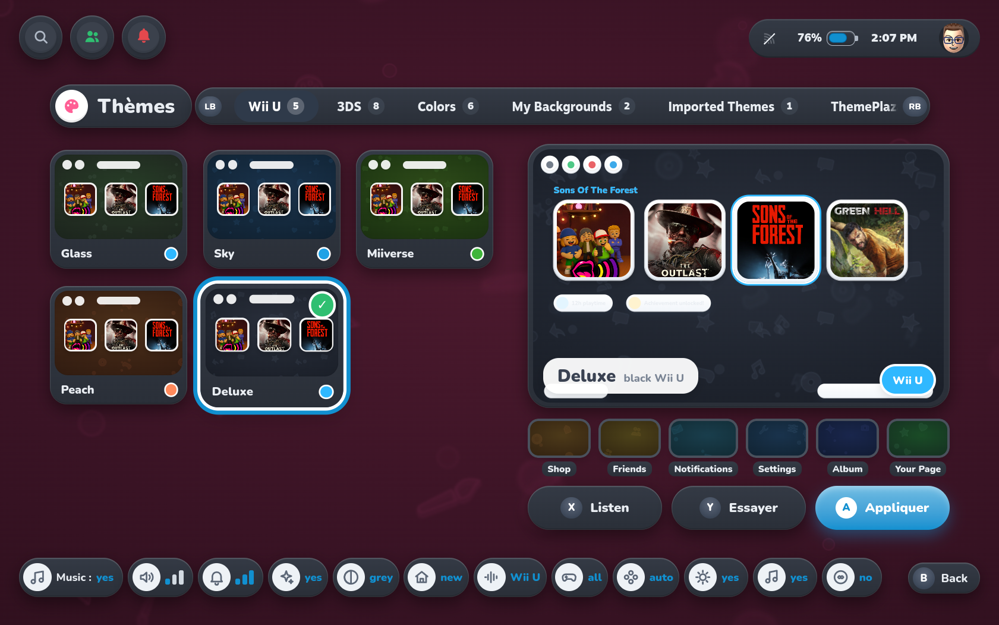
</details>

<details>
<summary>Settings</summary>
<br>

SteamU's own settings tab, next to Steam's own Settings app: contributors, importing files, and your apps'
status.

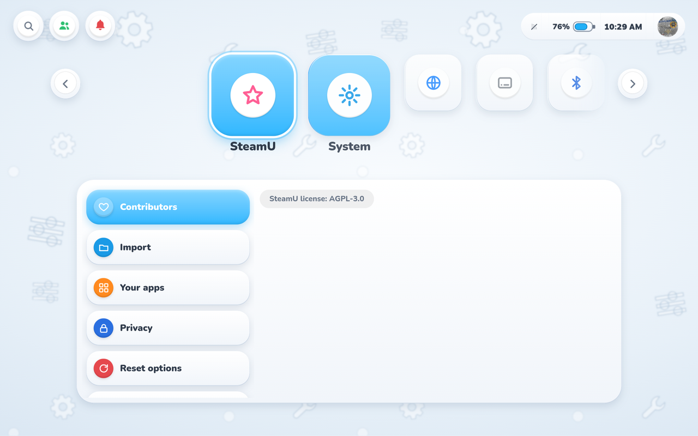
</details>

## What works out of the box

Grid home screen, HOME menu, quick settings, themes (light/grey/black variants), the music player, notifications,
and SteamU's own original sounds and music. No extra files needed.

## What needs YOUR OWN files

Real Miis, the Mii Maker, the casino and badges, and Nintendo console sounds all need files that **you** import
from hardware **you** own. SteamU bundles **no Nintendo file of any kind**: no ROM, no firmware, no sound bank,
no 3D model. It does bundle the open-source [FFL.js](https://github.com/ariankordi/FFL.js) bindings (AGPL-3.0,
see `decky/steamu/donnees/mii-moteur/SOURCE.md`) so real Miis need fewer imported files than before. A few
shader/engine files that FFL.js publishes but whose license doesn't cover the Nintendo content inside them are
not bundled either: the "Mii engine" zone in Settings → SteamU → Import has an **Install** button that fetches
exactly those files from the official FFL.js repository (pinned version, checked against fingerprints shipped in
the plugin). SteamU downloads nothing unless you ask, and only from the FFL.js project. The face resource file
and the Mii bodies still need your own import. Settings → SteamU → Import explains exactly what it recognises and
what is still missing. Importing is entirely optional; nothing else depends on it.

Once real Miis are imported, the plaza is never empty: if you have few Miis of your own, a cast of SteamU's own
Miis (made by us, not Nintendo's) fills it. Keep an eye on your home screen too: a few rare visitors may drop by…

## Install

**Prerequisites**: [Decky Loader](https://decky.xyz) installed, and Steam running in Game Mode / Big Picture
(that's the UI SteamU themes; it won't do anything in desktop-mode Steam).

1. **Enable Decky's Developer mode**: open the Decky menu (the plug icon next to Quick Access) → Settings →
   General → turn on "Developer mode".
2. **Install the plugin**: still in Decky, open the new Developer tab, then either:
   - **From a zip**: "Install Plugin from ZIP File" → pick `SteamU-v<version>.zip` (built from
     `decky/steamu/`, see "Building from source" below, or downloaded from a GitHub Release once one
     exists); or
   - **From a URL**: "Install from URL" → paste the direct link to the `SteamU-v<version>.zip` asset of a
     GitHub Release.
3. **First launch**: restart Steam if the interface doesn't change right away (Steam → Power → Restart Steam, or
   just exit and relaunch).

**Updating**: repeat the install step with the new zip/URL. It replaces the old version in place, no need to
uninstall first.

**Uninstalling cleanly**: Decky menu → Developer tab (or the plugin list) → remove "SteamU". This also removes the startup video SteamU installs; nothing else on your system is
touched.

## Known conflicts

SteamU restyles Steam's Big Picture UI by injecting its own stylesheet and scripts into Steam's windows. Any
other plugin doing the same thing to the same windows can visually clash with it. SteamU detects the two it
knows about and shows a one-time notice (Settings → SteamU) when it sees them installed. It never disables
anything on its own, it just tells you:

- **CSS Loader (SDH-CssLoader)**: if you have a CSS Loader theme active on Big Picture, turn it off (or disable
  SteamU): running both at once gives unpredictable results, not a crash.
- **Game Glance**: its game-page replacement and "Spotlight Home" can cover the same screens as SteamU's game
  page and home screen; turn those off in Game Glance while using SteamU.
- **Other Big Picture skin/theme plugins or home-screen replacers SteamU doesn't know about yet**: same advice,
  use one at a time. Please open an issue naming the plugin so it can be added to the detector.

## Building from source

The plugin is plain, unbundled JS/Python: no `npm install` or build step is required. To produce an
installable zip:

```sh
cd decky
zip -r SteamU.zip steamu
```

Decky's "Install plugin from ZIP" expects the plugin folder (containing `plugin.json`) at the root of the zip.

## If Steam misbehaves

- **Emergency stop**: hold L3 + R3 (click both sticks) for 4 seconds on any Steam screen. SteamU stops and Steam
  reloads its own original interface until the next restart.
- **Turn SteamU off from Decky**: the plugin's own quick-access panel has an "SteamU enabled" switch.
- **Diagnostic report**: Settings → SteamU → the plugin can write a zip to your Downloads folder with logs and
  version info for a bug report; it scrubs usernames, account names/IDs, serial numbers, and IP/MAC addresses
  before writing anything (see `py_modules/diagnostic.py`).
- To go back entirely: uninstall the plugin from Decky.

## Identifiers are mostly French

The development team is French-speaking, and most function/variable names, and the code comments that existed
before this export stripped them, were written in French. Pull requests that keep existing French identifiers
(rather than renaming wholesale) and add English comments are very welcome; full renaming is a larger
conversation best had in an issue first.

## How SteamU was made

SteamU was written with help from AI. Most of the code was generated by Claude (Anthropic's AI model), following
my direction. I designed the features and the look, then decided what to keep or drop. I tested everything on real
hardware (a Lenovo Legion Go 2 running Bazzite) and on a test machine, and reviewed the parts that matter most
(safety net, import tool, privacy, licenses). Not every line was reviewed by hand, so please treat it as a test
build and report anything odd. Contributions and code reviews are gladly welcome.

## Status and scope

This is a hobby project, built and tested on a single device (Lenovo Legion Go 2, 1920×1200) and a handful of
testers' Steam Decks. Expect some screens to look better on one screen size than another, and some strings to
still be French-only. No telemetry, no analytics, no network calls beyond the few documented, opt-in integrations
described in `ARCHITECTURE.md`.

What's planned next (performance first) is in [`ROADMAP.md`](ROADMAP.md); what changed in each version is in
[`CHANGELOG.md`](CHANGELOG.md).

## Translations

SteamU speaks English, French and Spanish, and follows Steam's language. All texts are in plain files, one per
language, in [`translations/`](translations/): no coding needed to fix a text or add a language. The short guide
is in [`translations/README.md`](translations/README.md).

## Contributors

- [@lieserlV](https://github.com/lieserlV): first tester; found the large-library crash (#1) and contributed the scrolling category row for libraries with many categories (#6, in v0.1.6).

## License

AGPL-3.0-or-later, see [`LICENSE`](LICENSE). Third-party code bundled for convenience (a DBus client, a
WebSocket client, a screen-colour sampler) keeps its own license notice in its own files/folder.

Rare visitors are fan-made tributes; all trademarks belong to their respective owners.
